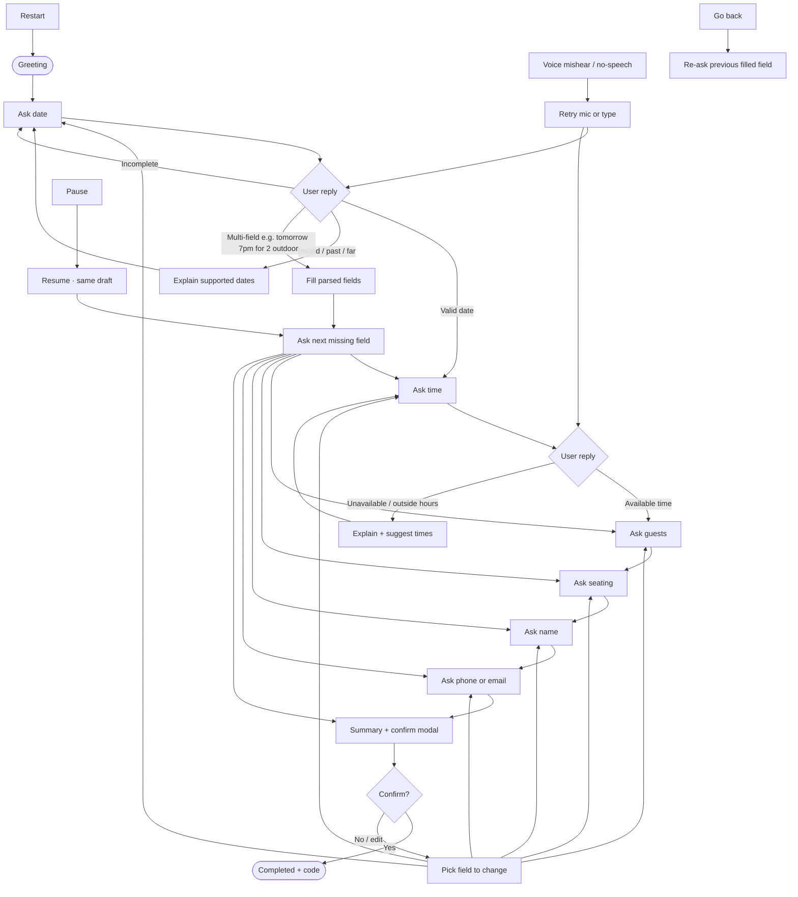

# Conversation flow — Ava / TableTalk

## Overview

Controlled dialogue with session memory. Ava asks for missing fields only, supports corrections, and requires explicit confirmation.

## Dialogue elements (required)

| Element | Implementation |
|--------|----------------|
| Opening / greeting | Ava introduces TableTalk and the booking task |
| Main goal | Reserve a table |
| Questions | date, time, guests, seating, name, contact |
| Possible answers | Natural language + quick-choice chips |
| Follow-ups | Ask only missing / ambiguous fields |
| Invalid / incomplete / unexpected | Clear explanations + examples |
| Correction path | Summary Edit, “change …”, Go back |
| Final confirmation | Modal + spoken/visible summary |
| Completion | Confirmation code + completed status |

## Error / recovery cases (≥2)

1. **Invalid or past date** — Ava explains and re-asks.
2. **Unavailable time** (e.g. Friday 6:00 PM demo sell-out) — Ava explains and suggests alternatives.
3. **Incomplete answer** — Ava restates what is still needed.
4. **Voice recognition problem** — Banner + retry mic or type instead.
