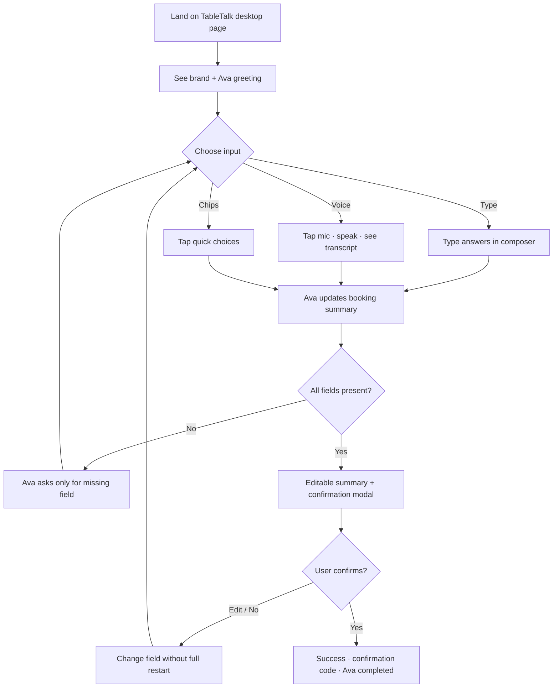

# User journey / task flow — Complete a reservation

## Goal

Book a restaurant table with Ava using voice and/or typed text, then confirm.

## Step-by-step

1. **Start** — User opens the site; TableTalk branding and Ava are the first viewport.
2. **Orient** — Ava greets, explains she books tables, and lists what she needs.
3. **Collect** — Date → time → guests → seating → name → one contact (phone or email). Multi-field utterances are accepted when parseable.
4. **Recover** — Invalid date, unavailable time, incomplete answer, or voice error → clear recovery without wiping the session.
5. **Control** — Pause, go back, edit summary rows, switch mic ↔ keyboard, or restart deliberately.
6. **Confirm** — Modal + spoken/visible summary; user must confirm before finalize.
7. **Complete** — Confirmation code; status **Completed**; option to book another.

## Success criteria for the journey

- Task completable by keyboard alone.
- Voice path available where SpeechRecognition is supported; graceful typed fallback otherwise.
- No payment or unnecessary sensitive data requested.
